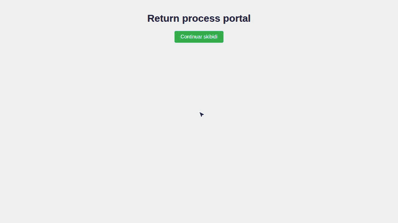
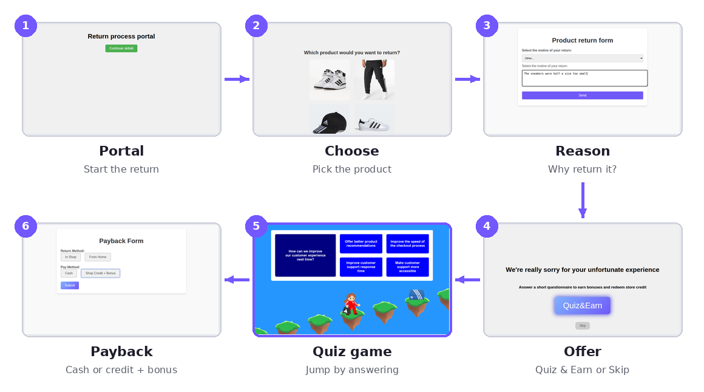
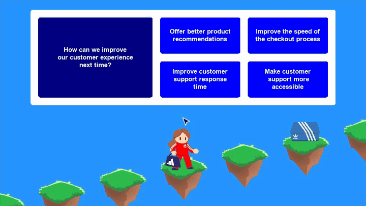
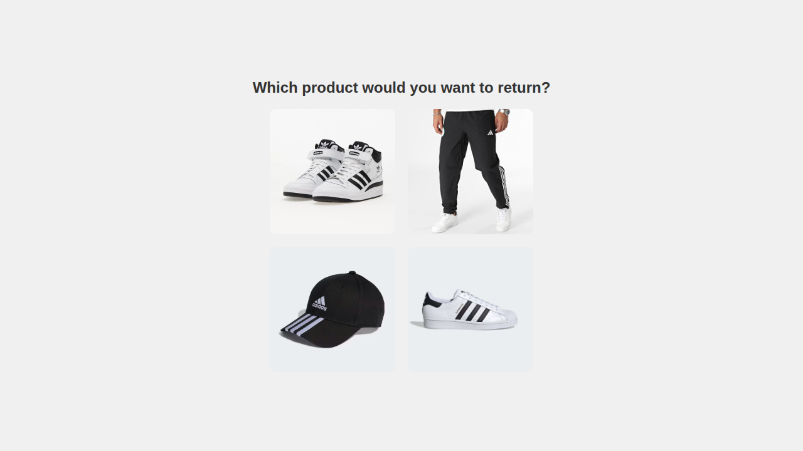
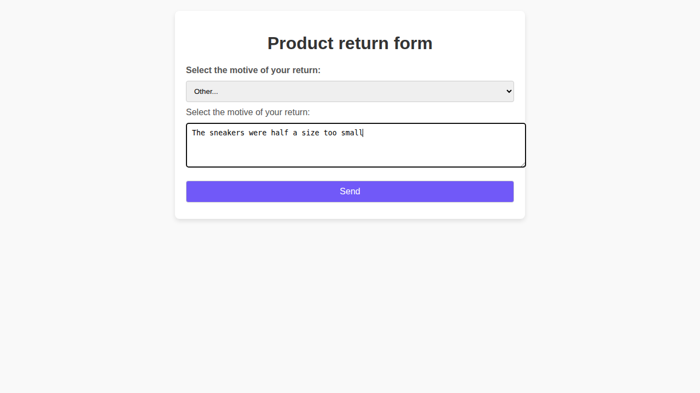
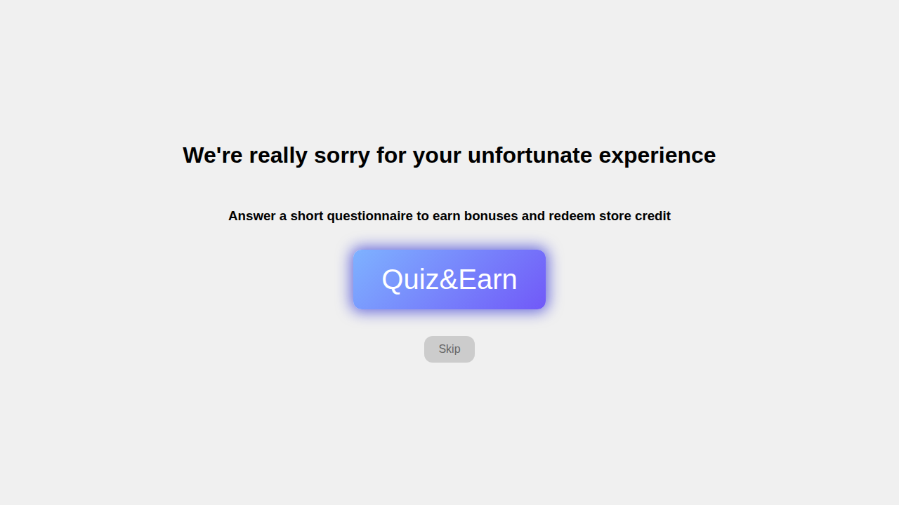
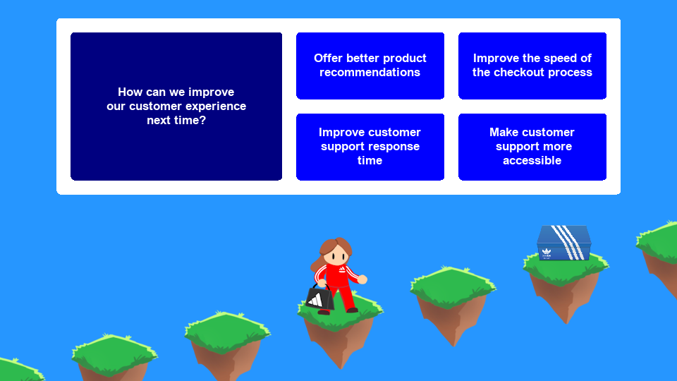
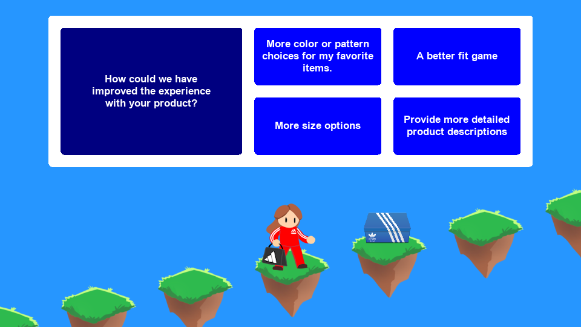
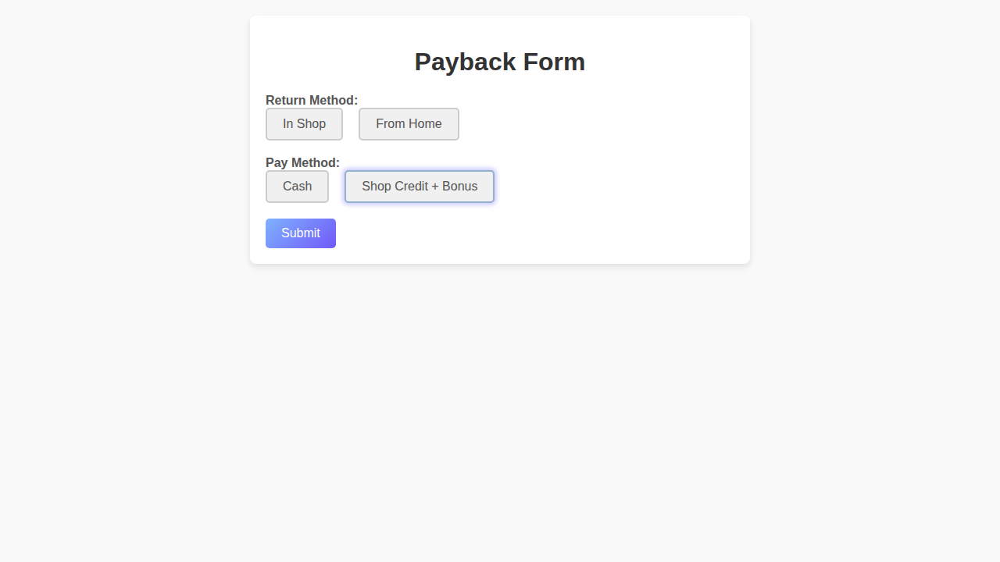

<div align="center">


# ZipBomb

### Turn a product return into a game and convert refunds into store credit.

<p>
  
  
  
  
  
</p>



<sub>The full flow, from the portal to the payback form, including the quiz game.</sub>

</div>

---

## 📖 Contents

- [The idea](#-the-idea)
- [How it works](#-how-it-works)
- [The quiz game](#-the-quiz-game)
- [Screenshots](#-screenshots)
- [Run it locally](#-run-it-locally)
- [Project structure](#-project-structure)
- [Editing the game](#-editing-the-game)

## 💡 The idea

Returns are a lost sale. The customer is unhappy, the store refunds the money, and nobody learns anything.

**ZipBomb** changes the moment of the return. Before choosing how to get their money back, the customer is offered a short **feedback quiz disguised as a mini platformer**. Every answer makes the character jump to the next floating island. At the end, the customer can pick **Shop Credit + Bonus** instead of cash.

| For the customer | For the store |
| :--- | :--- |
| 🎮 A fun 30-second game instead of a boring form | 🗣️ Real feedback on why products come back |
| 🎁 A bonus on top of their store credit | 💳 Refunds become store credit, so the sale stays in the shop |
| ⏭️ Can always skip it | 📊 Answers on product, sizing, support and loyalty |

## 🧭 How it works

<div align="center">
  
</div>

1. **Portal**: the customer starts the return process.
2. **Choose**: they pick the product to return from a grid.
3. **Reason**: wrong product, broken, not as described, or *Other...* with free text.
4. **Offer**: *"Answer a short questionnaire to earn bonuses and redeem store credit"*, with **Quiz&Earn** or **Skip**.
5. **Quiz game**: five questions, one per island (see below).
6. **Payback**: return in shop or from home, and refund as **Cash** or **Shop Credit + Bonus**.

## 🎮 The quiz game

<div align="center">
  
</div>

The game is a small isometric platformer built in **GameMaker** and exported to HTML5. The character starts on the first island with a question floating above. **Click an answer** and the character jumps to the next island. The landing makes the platform bounce, and the shoe boxes along the way disappear when touched.

<details>
<summary><b>📝 The questions</b></summary>

<br>

| # | Question | Answers |
| :-: | :--- | :--- |
| 1 | How can we improve our customer experience next time? | Better product recommendations · Faster checkout · Faster support response · More accessible support |
| 2 | How could we have improved the experience with your product? | More colors or patterns · A better fit game · More size options · More detailed descriptions |
| 3 | How likely are you to shop with us again? | Very likely · Somewhat likely · Neutral · Unlikely |
| 4 | Which of the following of our products do you like the most? | Product placeholders |
| 5 | We strive to improve our customer experience with every interaction! Which of the following do you think is the most important? | Faster shipping · Better support · More product variety · More intuitive website |

When the character reaches the last island, the game sends the customer straight to the payback form.

</details>

<details>
<summary><b>⌨️ Controls</b></summary>

<br>

| Input | Action |
| :--- | :--- |
| 🖱️ Click an answer | Answer and jump to the next island |
| <kbd>S</kbd> | Skip the game and go to the payback form |
| <kbd>←</kbd> | Shake the current platform *(debug)* |
| <kbd>0</kbd>–<kbd>5</kbd> | Jump straight to a question *(debug)* |

</details>

<details>
<summary><b>🎨 Sprites</b></summary>

<br>

<div align="center">

| Player (idle) | Player (jumping) | Player (crouch / landing) | Shoe box | Island |
| :-: | :-: | :-: | :-: | :-: |
|  |  |  |  |  |

</div>

</details>

## 📸 Screenshots

<table>
  <tr>
    <td align="center"><br><b>Choose the product</b></td>
    <td align="center"><br><b>Tell us why</b></td>
  </tr>
  <tr>
    <td align="center"><br><b>Quiz &amp; Earn offer</b></td>
    <td align="center"><br><b>Quiz game</b></td>
  </tr>
  <tr>
    <td align="center"><br><b>Every answer is a jump</b></td>
    <td align="center"><br><b>Cash or credit + bonus</b></td>
  </tr>
</table>

## 🚀 Run it locally

The game is a GameMaker HTML5 export, so it has to be **served over HTTP**. Opening the files directly with `file://` won't work.

```bash
git clone git@github.com:U4rn4/ZipBomb.git
cd ZipBomb/web
python3 -m http.server 8000
```

Then open **http://localhost:8000** and click through the return.

> [!TIP]
> Any static server works too, for example `npx serve web` or the VS Code *Live Server* extension.

## 🗂️ Project structure

```text
ZipBomb/
├── web/                     # The website (this is what you serve)
│   ├── index.html           # 1. Return portal
│   ├── page2.html           # 2. Product picker
│   ├── page3.html           # 3. Return reason form
│   ├── page4.html           # 4. Quiz & Earn offer
│   ├── gameparkour.html     # 5. Quiz game (centered canvas)
│   ├── game.html            #    Same game, default GameMaker page
│   ├── page5.html           # 6. Payback form
│   ├── images/              # Product photos
│   └── html5game/           # GameMaker HTML5 export (JS + textures)
│
├── minigame/                # GameMaker project source
│   ├── IsometricFull.yyp    # Open this in GameMaker
│   ├── objects/             # obj_player, obj_platform, obj_box, obj_camera, obj_game
│   ├── sprites/             # Player, island and shoe box art
│   ├── animcurves/          # ac_land / ac_shake platform animations
│   ├── rooms/room0/         # Level layout and the quiz texts
│   └── html5game/           # Previous HTML5 export
│
└── docs/                    # README images and GIFs
```

## 🛠️ Editing the game

1. Open `minigame/IsometricFull.yyp` in **GameMaker** (made with IDE 2024.8).
2. The questions and answers are **instance variables** of the `obj_platform` instances in `room0`: `text_question`, `text_answer0` to `text_answer3`. Change them in the room editor.
3. Export with the **HTML5** target and replace `web/html5game/` with the new export.

<details>
<summary><b>How the game works inside</b></summary>

<br>

- **`obj_player`** stores the current question and, on a click, plays a short crouch, then a parabolic jump over 45 frames to the next platform (`jump_to` → `jump_to_alarm`). When it lands it calls `land()` on the platform. When it reaches `question_5` it opens `page5.html`.
- **`obj_platform`** draws the question panel on the GUI layer, detects clicks on the four answer boxes, and animates its own `y` with the `ac_land` and `ac_shake` animation curves.
- **`obj_camera`** follows the player with smoothing (`x += (target - x) / 10`).
- **`obj_box`** disappears 20 frames after the player touches it.
- **`obj_game`** holds the list of questions and the <kbd>S</kbd> shortcut that skips to the payback form.

</details>

---

<div align="center">
  <br>
  <sub>Made at a hackathon, with a lot of jumping.</sub>
</div>
